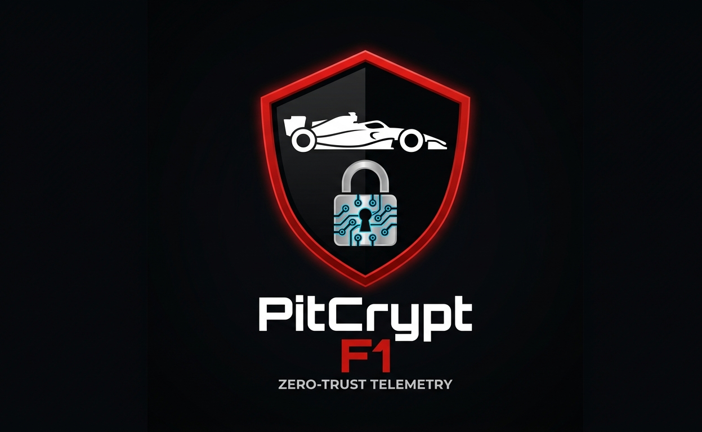

 <div align="center">



# PitCrypt-F1

### Zero-Trust Security Framework for Formula 1 Telemetry Streams

[](https://python.org)
[](https://rust-lang.org)
[](#test-coverage)
[](LICENSE)
[](#project-status)

**Car Producer → Relay Node → FIA Validator → Audit Trail**

A telemetry security prototype combining cryptographic authentication, authenticated encryption, replay protection, anomaly detection, access control, and telemetry analysis using real F1-derived data.

</div>

---

## What Is PitCrypt-F1?

PitCrypt-F1 is a zero-trust security framework prototype for protecting Formula 1 telemetry as it moves from a simulated car-side producer through a relay node to a validator.

The project combines three engineering concerns:

- **Telemetry engineering:** ingesting, filtering, packetizing, and analysing time-series telemetry.
- **Cybersecurity:** protecting packet confidentiality and integrity, authenticating producers, detecting replay attempts, and enforcing node access policies.
- **Observability:** recording validation decisions and presenting telemetry and security events in a Streamlit dashboard.

The telemetry dataset is derived from the FastF1 API and includes data from five constructors across thirteen circuits. The framework uses a three-stage processing pipeline:

1. The car producer builds and signs telemetry packets, then encrypts them for the relay.
2. The relay decrypts and inspects packets, performs integrity and anomaly checks, and re-encrypts accepted traffic for the validator.
3. The validator decrypts the forwarded packet, checks the producer signature and sequence metadata, verifies the configured commitment, and records its decision.

The repository includes Python tests, attack simulations, security documentation, a Rust zero-knowledge-proof module, and tools for telemetry analysis.

> **Scope:** PitCrypt-F1 is a research and portfolio prototype. It is not an FIA-certified system or a production-deployed Formula 1 telemetry security solution.

---

## Security Architecture

### Cryptographic stack

| Purpose | Primitive | Standard / reference |
|---|---|---|
| Session key agreement | X25519 ECDH | RFC 7748 |
| Key derivation | HKDF-SHA256 | RFC 5869 |
| Authenticated encryption | ChaCha20-Poly1305 | RFC 8439 |
| Digital signatures | Ed25519 | RFC 8032 |
| Hashing | SHA-256 | FIPS 180-4 |
| Commitment verification | Python hash-commitment mode; Rust Pedersen implementation | ADR-002 |
| Range proofs | Bulletproofs in the Rust ZKP module | Bünz et al., 2018 |

The Python implementation uses the PyCA `cryptography` library for its supported cryptographic operations.

The listed primitives have established cryptographic specifications, but overall security depends on their implementation, key management, protocol design, configuration, and operational environment. The project has not undergone an independent security audit.

### Pipeline architecture

```text
┌──────────────────────────────────────────────────────────────┐
│ CAR PRODUCER                                                  │
│                                                              │
│ SensorSimulator → PacketBuilder → PacketSigner → Encryptor   │
│ FastF1-derived data   64-byte header   Ed25519   ChaCha20-    │
│                                                  Poly1305     │
└──────────────────────────────┬───────────────────────────────┘
                               │
                       X25519 ECDH session A
                               │
                               ▼
┌──────────────────────────────────────────────────────────────┐
│ RELAY NODE                                                    │
│                                                              │
│ PacketParser → Decryptor → IntegrityChecker → AnomalyFilter │
│                                      │                       │
│                                      ▼                       │
│                                  ReEncryptor                 │
└──────────────────────────────┬───────────────────────────────┘
                               │
                       X25519 ECDH session B
                               │
                               ▼
┌──────────────────────────────────────────────────────────────┐
│ FIA VALIDATOR                                                 │
│                                                              │
│ Decrypt → SignatureVerifier → Header/Metadata Consistency    │
│                                      │                       │
│                                      ▼                       │
│                         SequenceChecker → ZKPVerifier        │
│                                      │                       │
│                                      ▼                       │
│                         Accept / Reject / Flag                │
│                                      │                       │
│                                      ▼                       │
│                                AuditLogger                   │
└──────────────────────────────────────────────────────────────┘
```

### Packet security

The pipeline implements the following controls:

- **Confidentiality:** authenticated encryption protects packet contents on each encrypted session leg.
- **Authenticity:** Ed25519 signatures allow the validator to verify packets against registered producer public keys.
- **Integrity:** authenticated encryption and signature verification detect relevant modifications.
- **Replay resistance:** relay-side integrity checks and validator-side sequence checks provide independent layers of replay defence.
- **Metadata consistency:** the validator checks the sequence number represented in the binary header against the outer packet metadata before downstream validation.
- **Anomaly detection:** telemetry values are checked against configured or calibrated statistical bounds.
- **Auditability:** validation decisions and rejection reasons can be recorded in the audit log.

The relay re-encrypts traffic for the validator rather than simply forwarding the original encrypted payload. The two encrypted legs use separately established session keys.

### Zero-trust access model

The intended node responsibilities are:

| Node | Responsibilities |
|---|---|
| Car producer | Produce, packetize, sign, encrypt, and transmit telemetry to the relay. |
| Relay | Receive, decrypt, inspect, re-encrypt, and forward traffic. |
| Validator | Verify packets, apply validation rules, and record decisions. |
| IAM module | Evaluate configured identity, role, and access policies. |

The design follows least-privilege principles and denies requests that fail the applicable identity or policy checks. Exact enforcement depends on the policy configuration and the code path being exercised.

---

## Real F1-Derived Telemetry

Telemetry is sourced through the FastF1 API and stored locally for simulation and analysis.

| Category | Supported data |
|---|---|
| Constructors | Mercedes-AMG, Red Bull Racing, Scuderia Ferrari, McLaren Racing, Williams Racing |
| Circuits | Bahrain, Saudi Arabia, Australia, Japan, Monaco, Singapore, Monza, Silverstone, Netherlands, Baku, Qatar, Abu Dhabi, São Paulo |
| Sessions | Race, qualifying, sprint, where available in the downloaded data |
| Channels | Speed, RPM, throttle, brake, gear, DRS, distance, X, Y |
| Analysis | Driver, lap, sector, track, and corner analysis |

The repository includes scripts to fetch telemetry, derive per-team baselines, retrieve circuit corner positions, and calibrate anomaly-detection thresholds.

Thresholds and baseline statistics depend on the downloaded dataset and configuration. They should not be interpreted as official FIA safety limits or universally valid physical constraints.

---

## Dashboard Features

The Streamlit dashboard is designed to make telemetry and security behaviour inspectable during simulation.

- **Telemetry feed:** driver, lap, speed, RPM, throttle, gear, and related packet fields.
- **Driver and lap selection:** filter telemetry for a selected driver or lap.
- **Telemetry charts:** inspect speed and RPM over packet sequence with separate axes.
- **Cryptographic pipeline monitoring:** view packet counts and session/key information exposed by the implementation.
- **Threat detection:** display and classify detected security events, including tampering, replay, IAM, commitment, and signature-related events where supported.
- **Attack injection:** demonstrate selected tampering, replay, and signature-forgery scenarios.
- **Team comparison:** inspect two independently configured pipelines.
- **Audit viewer:** inspect recorded validator decisions and timestamps.
- **Anomaly statistics:** review rejection and anomaly information exposed by the dashboard.

Dashboard features depend on the selected dataset, available fields, runtime configuration, and installed dependencies.

---

## Security Simulation Results

The repository contains scripts for tampering, replay, and IAM breach scenarios.

### Tampering scenarios

The documented simulation scenarios include:

| Attack scenario | Intended defence |
|---|---|
| Payload bit modification | Authenticated encryption |
| Telemetry value injection | Packet authentication and signature verification, depending on where modification occurs |
| Signature stripping | Signature validation and rejection of missing authentication data |
| Commitment modification | Commitment verification |
| Authenticated-header modification | AEAD authentication |
| Invalid signature | Ed25519 verification |
| Multi-layer modification | The earliest applicable integrity control |

The automated test suite now includes a passing test that corrupts a byte in the 64-byte Ed25519 signature and verifies that the validator rejects the packet.

**Simulation results are not a substitute for independent attack evaluation.** The actual defence depends on the attack location, the fields modified, and the validation path reached.

### Replay scenarios

The repository includes replay simulations covering scenarios such as duplicate packets, manipulated sequences, batches of repeated packets, and delayed traffic.

Replay resistance depends on sequence-state management and packet validation. Sequence manipulation must be tested against the actual binary-header, signature, and metadata-validation paths rather than assumed to be detected by one control in every circumstance.

See [`docs/THREAT_MODEL.md`](docs/THREAT_MODEL.md) for the documented threat assumptions and limitations.

### IAM scenarios

The IAM simulation exercises access-control scenarios involving unknown identities, cross-team access, direct-path attempts, relay impersonation, privilege escalation, audit-log tampering, and request storms.

The results should be evaluated against the configured policy and the assertions in the relevant tests. A simulation result does not establish that every possible IAM bypass has been eliminated.

---

## Test Coverage

### Latest verified result

The most recent full-project test run completed successfully:

```text
422 passed in 448.30s (0:07:28)
```

That run reported zero failures and zero skipped tests.

The suite includes tests across the car producer, relay, validator, IAM, and related project modules. The exact count may change as tests are added or modified.

Run the complete suite from the repository root:

```bash
python -m pytest -q
```

Run the packet-integrity tests:

```bash
python -m pytest ./validator-node/tests/test_packet_integrity.py -q
```

Run the validator tests:

```bash
python -m pytest ./validator-node/tests -q
```

On Windows PowerShell, the equivalent commands using backslashes are also supported.

### Security tests recently verified

The packet-integrity tests cover:

- Ciphertext tampering.
- Authenticated-header tampering.
- Header/outer-metadata sequence mismatch, including stopping downstream validation.
- Invalid Ed25519 signature rejection.

Other existing tests cover replay handling, validator sequencing, audit events, and additional project functionality.

**Passing tests demonstrate the behaviour exercised by those tests, not proof of complete security.** Further work should expand adversarial cases, validate key-rotation and failure behaviour, test Rust integration, and benchmark runtime performance.

---

## Quick Start

### Prerequisites

- Python 3.11 or newer
- Git
- A local telemetry dataset for workflows that depend on downloaded data
- Rust and Cargo for the Rust ZKP module

### Clone and install

Replace the repository URL below with the actual public GitHub URL if you are cloning from a fork.

```bash
git clone https://github.com/<your-username>/pitcrypt-f1.git
cd pitcrypt-f1

python -m venv f1env
```

Activate the environment.

**Windows PowerShell:**

```powershell
.\f1env\Scripts\Activate.ps1
```

**Windows Command Prompt:**

```bat
f1env\Scripts\activate.bat
```

**macOS / Linux:**

```bash
source f1env/bin/activate
```

Install the dependencies:

```bash
python -m pip install --upgrade pip
pip install -r requirements.txt
```

If the dashboard dependencies are not already included:

```bash
pip install streamlit plotly
```

### Run the validator

```bash
python validator-node/src/main.py
```

The actual output depends on the local configuration, keys, telemetry data, and startup path. The validator should be tested using the repository's fixtures and configured demonstration pipeline rather than assuming a fixed number of packets will always be accepted.

### Run attack simulations

```bash
python simulations/replay_attack_sim.py
python simulations/tampering_sim.py
python simulations/iam_breach_sim.py
```

### Run the dashboard

```bash
streamlit run dashboard/app.py
```

### Run tests

```bash
python -m pytest -q
```

### Generate or process telemetry data

Run the applicable scripts from the repository root:

```bash
python forensic/fetch_telemetry.py
python forensic/fetch_one_team.py
python forensic/fetch_circuit_corners.py
python forensic/forensic_analysis.py
python forensic/calibrate_thresholds.py
```

These scripts may require network access, valid dependencies, API availability, and local data directories. Some fetch scripts may be subject to rate limits.

---

## Project Structure

```text
pitcrypt_f1/
├── car_producer/
│   ├── src/
│   │   ├── sensor_simulator.py
│   │   ├── corner_lookup.py
│   │   ├── packet_builder.py
│   │   ├── signer.py
│   │   ├── encryptor.py
│   │   ├── crypto_engine.py
│   │   └── key_scheduler.py
│   └── tests/
│
├── relay-node/
│   ├── src/
│   │   ├── packet_parser.py
│   │   ├── decryptor.py
│   │   ├── integrity_checker.py
│   │   ├── anomaly_filters.py
│   │   └── reencryptor.py
│   ├── config/
│   └── tests/
│
├── validator-node/
│   ├── src/
│   │   ├── signature_verifier.py
│   │   ├── sequence_checker.py
│   │   ├── zkp_verifier.py
│   │   ├── audit_logger.py
│   │   └── main.py
│   ├── config/
│   └── tests/
│
├── iam-module/
│   ├── src/
│   │   ├── identity_store.py
│   │   ├── policy_loader.py
│   │   ├── rbac_engine.py
│   │   └── access_auditor.py
│   ├── policies/
│   ├── config/
│   └── tests/
│
├── forensic/
│   ├── fetch_telemetry.py
│   ├── fetch_one_team.py
│   ├── fetch_circuit_corners.py
│   ├── forensic_analysis.py
│   ├── calibrate_thresholds.py
│   └── visualise_telemetry.py
│
├── simulations/
│   ├── replay_attack_sim.py
│   ├── tampering_sim.py
│   ├── iam_breach_sim.py
│   ├── packet_loss_sim.py
│   ├── jitter_sim.py
│   └── results/
│
├── zkp-module/
│   ├── Cargo.toml
│   └── src/
│       ├── lib.rs
│       ├── commitments.rs
│       ├── proof_system.rs
│       ├── transcript.rs
│       └── errors.rs
│
├── dashboard/
│   ├── app.py
│   ├── assets/
│   └── components/
│
├── architecture/
│   └── adr/
│
├── docs/
│
└── data/                 # Local/generated data; typically gitignored
    ├── raw/
    ├── processed/
    └── circuits/
```

---

## Architecture Decision Records

| ADR | Decision | Rationale |
|---|---|---|
| [ADR-001](architecture/adr/001-crypto-choice.md) | X25519, ChaCha20-Poly1305, Ed25519 | Standardised primitives for key agreement, authenticated encryption, and signatures |
| [ADR-002](architecture/adr/002-zkp-commitments.md) | Pedersen commitments and Bulletproofs | Design for commitments and range proofs |
| [ADR-003](architecture/adr/003-key-rotation-policy.md) | Time- and volume-based rotation policy | Bound session-key usage by time and packet volume |
| [ADR-004](architecture/adr/004-iam-rbac-model.md) | Role-based access control | Explicit and auditable role policies |
| [ADR-005](architecture/adr/005-cloud-kms-choice.md) | AWS KMS/HSM design decision | Intended approach for production identity-key protection |

The ADRs describe architectural decisions and intended controls. They do not imply that every production-oriented component, including hardware-backed key management, is deployed in the current prototype.

---

## Security Documentation

| Document | Description |
|---|---|
| [Threat Model](docs/THREAT_MODEL.md) | STRIDE analysis and documented threats |
| [MITRE ATT&CK Mapping](docs/MITRE_ATTACK_MAPPING.md) | Mapping of selected ATT&CK techniques to controls |
| [Threat Intelligence](docs/THREAT_INTELLIGENCE.md) | Threat actors, CVEs, and attack context |
| [Packet Format](docs/PACKET_FORMAT.md) | Binary packet-format documentation |
| [Cryptographic Primitives](docs/CRYPTOGRAPHIC_PRIMITIVES.md) | Cryptographic design and primitive choices |
| [Key Management](docs/KEY_MANAGEMENT.md) | Key hierarchy, rotation, and compromise considerations |
| [Architecture Overview](docs/ARCHITECTURE_OVERVIEW.md) | System architecture |
| [Network Topology](docs/NETWORK_TOPOLOGY.md) | Node connectivity and data flow |
| [Protocol Specification](docs/PROTOCOL_SPEC.md) | Protocol behaviour and message flow |
| [FIA Data Privacy Model](docs/FIA_DATA_PRIVACY_MODEL.md) | Data-protection design considerations |
| [FIA Regulation Mapping](docs/FIA_REGULATION_MAPPING.md) | Regulation-to-control mapping |
| [Forensic Analysis](docs/FORENSIC_ANALYSIS.md) | Telemetry baselines and analysis |

---

## Project Status

| Component | Status |
|---|---|
| Car producer pipeline | Implemented and tested |
| Relay processing pipeline | Implemented and tested |
| Validator pipeline | Implemented and tested |
| IAM module | Implemented and tested |
| Attack simulation scripts | Implemented; continue expanding coverage |
| Telemetry ingestion and analysis | Implemented for supported datasets and workflows |
| Streamlit dashboard | Implemented; manual smoke testing remains useful |
| Security documentation | Available; should evolve with the implementation |
| Driver and lap filtering | Implemented for supported data paths |
| Corner lookup | Further validation and refinement |
| Rust ZKP module | Integration and verification work remains |
| Performance benchmarking | Planned / requires measured results |
| Independent security review | Not yet established |
| Research paper | Planned |

### Next engineering milestones

1. Expand adversarial tests for malformed packets, replay edge cases, key rotation, and session isolation.
2. Benchmark throughput, median latency, p95 latency, and packet-loss behaviour under documented workloads.
3. Complete and test the Rust ZKP integration.
4. Verify dashboard behaviour against actual validator outcomes.
5. Document limitations and reproducible test/benchmark procedures.
6. Consider independent security review before making production-readiness claims.

---

## Intended Research and Academic Applications

PitCrypt-F1 is a portfolio project at the intersection of cybersecurity, applied cryptography, software systems, and motorsport telemetry engineering.

Potentially relevant academic areas include:

- Cybersecurity and information security
- Applied cryptography and protocol design
- Secure systems engineering
- Automotive and motorsport data systems
- Telemetry integrity, anomaly detection, and observability

The project can serve as a practical demonstration of engineering work, provided the implementation details, test results, limitations, and unfinished components are described accurately.

---

## License

MIT — see [LICENSE](LICENSE).

<div align="center">

*Built with real F1-derived telemetry · Cryptographic protection · Zero-trust design*

**Car → Relay → Validator → Audit**

</div>
